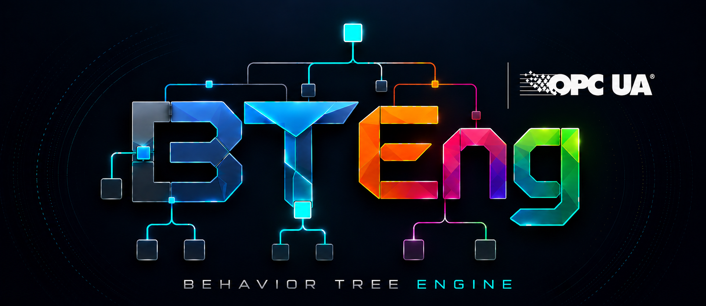

<p align="center">
  
</p>

# bteng-opcua

OPC UA integration for the [BTEng](https://github.com/BTEng-dev/bteng) Behavior Tree engine, for behavior-tree-based communication and control in industrial automation.

- 12 async OPC UA leaf nodes for connections, reads and writes, subscriptions, history access, and method calls, plus a generic `Sleep` helper
- Registry generated from the server's information model with `bteng-opcua harvest`, so addresses and data types are not written by hand
- Trees run from the command line with `bteng-opcua run`, with no Python to write

All OPC UA nodes implement the `StatefulActionNode` protocol: they return `RUNNING` while an async operation is in flight, then `SUCCESS` or `FAILURE` on completion.

## Requirements

- Python 3.12+
- [bteng](https://github.com/BTEng-dev/bteng) >= 0.3.2
- [asyncua](https://github.com/FreeOpcUa/opcua-asyncio) >= 1.0.0
- PyYAML >= 6.0

## Installation

`bteng-opcua` is not on PyPI yet, so install it from GitHub:

```bash
pip install git+https://github.com/BTEng-dev/bteng-opcua.git
```

## Quick start

Describe what to harvest. This is the only file you write by hand:

```yaml
# harvest.yaml
server: opc.tcp://192.168.1.10:4840     # or: nodeset: models/robot.NodeSet2.xml
harvest:
  - "Objects/Robot"                     # every Variable and Method underneath
```

Generate the registry, then run a tree against it:

```bash
bteng-opcua harvest -s harvest.yaml -o nodes.yaml           # generate; commit nodes.yaml
bteng-opcua harvest -s harvest.yaml -o nodes.yaml --check   # CI: fail if the model drifted
bteng-opcua run tree.xml -n nodes.yaml                      # run a tree
```

Generation is a build step: trees run offline against the committed YAML, and the server is contacted only when you regenerate. Aliases default to the snake_cased BrowseName (`MoveToPosition` becomes `move_to_position`).

A tree addresses nodes by alias, so no node IDs or data types appear in the XML:

```xml
<BTEng format_version="1.0" main_tree_to_execute="main">
  <Tree ID="main">
    <Sequence name="root">
      <OpcUaConnect name="connect" endpoint="opc.tcp://localhost:4840" session_id="main"/>
      <OpcUaRead name="read_temp" session_id="main" node_alias="temperature"
                 value="{current_temp}"/>
      <OpcUaDisconnect name="disconnect" session_id="main"/>
    </Sequence>
  </Tree>

  <!-- Required for value="{key}" to WRITE to the blackboard. -->
  <TreeNodesModel>
    <Action ID="OpcUaRead"><output_port name="value"/></Action>
  </TreeNodesModel>
</BTEng>
```

> **Declare output ports in `<TreeNodesModel>`.** Without it the parser treats every `{key}` attribute as an input, and `OpcUaRead` silently falls back to storing under its alias.

## Nodes

| Node | Purpose |
|---|---|
| `OpcUaConnect` | Establish a named OPC UA session |
| `OpcUaDisconnect` | Close a session (best-effort) |
| `OpcUaReconnect` | Re-establish a dropped session using its saved config |
| `OpcUaRead` | Read one variable node to the blackboard |
| `OpcUaWrite` | Write one variable node from the blackboard |
| `OpcUaBatchRead` | Read multiple nodes in a single round-trip |
| `OpcUaBatchWrite` | Write multiple nodes in parallel |
| `OpcUaCallMethod` | Invoke an OPC UA method with typed input/output args |
| `OpcUaSubscribe` | React to data-change notifications (`on_change` or `on_value` mode) |
| `OpcUaWaitForValue` | Poll a node until its value matches an expected value |
| `OpcUaReadHistory` | Read a time-windowed history from a HistoricalAccess node |
| `OpcUaCondition` | Read a node and check it against an expected value |

Nodes resolve addresses through a registry alias (`node_alias`, recommended) or directly with a raw `node_id` and `node_index`.

## Try it

Run everything against the bundled demo server:

```bash
python examples/demo_server.py                                   # terminal 1
bteng-opcua harvest -s examples/config/harvest.yaml -o examples/config/nodes.yaml
bteng-opcua run examples/trees/ -n examples/config/nodes.yaml
```

See [`examples/README.md`](examples/README.md) for the project layout.

## Documentation

- [Authoring guide](docs/authoring-nodes.md): full walkthrough from harvest spec to running tree
- [Reference](docs/reference.md): harvest authentication, registry format, data types, sessions, and Python/XML integration
- [Changelog](CHANGELOG.md)

## Development

```bash
pip install -e ".[dev]"
pytest tests/
```

`tests/test_subscribe_integration.py` needs a real OPC UA server.

## License

[MIT](LICENSE)
